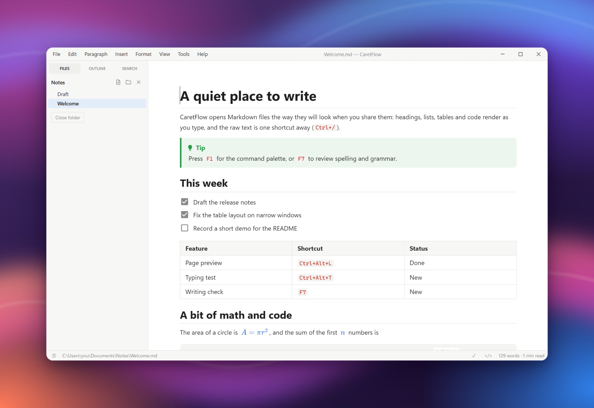
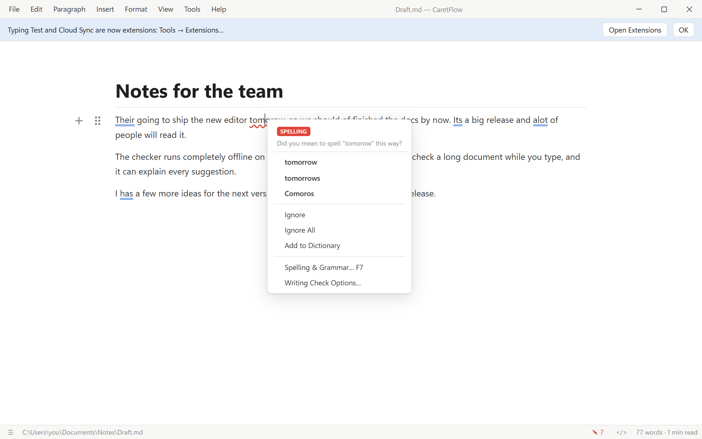
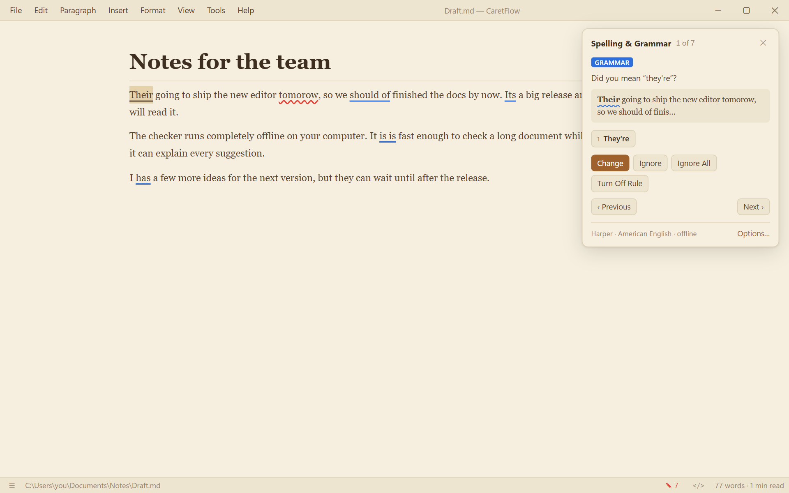
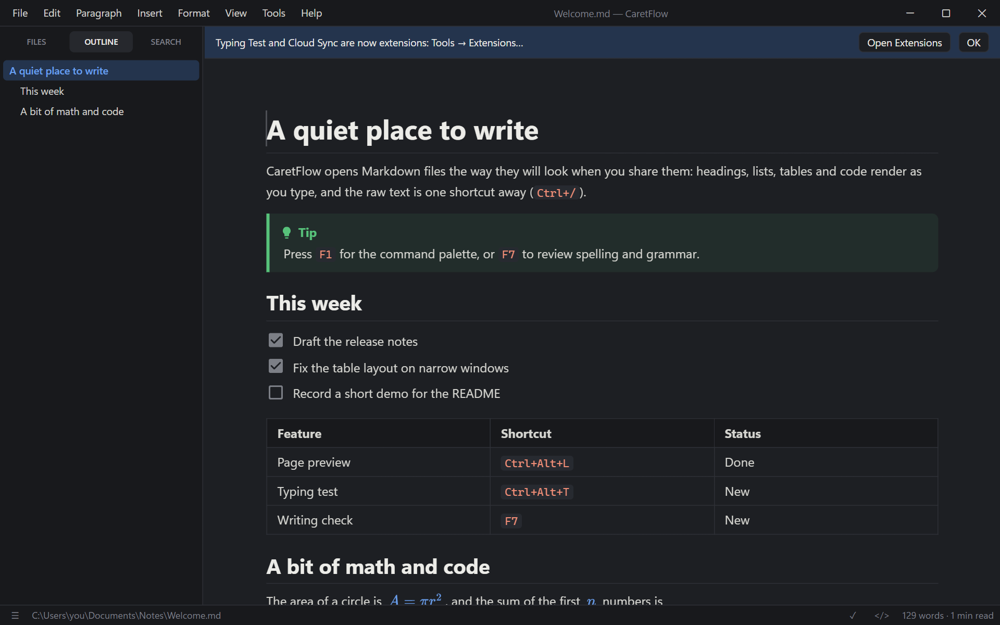
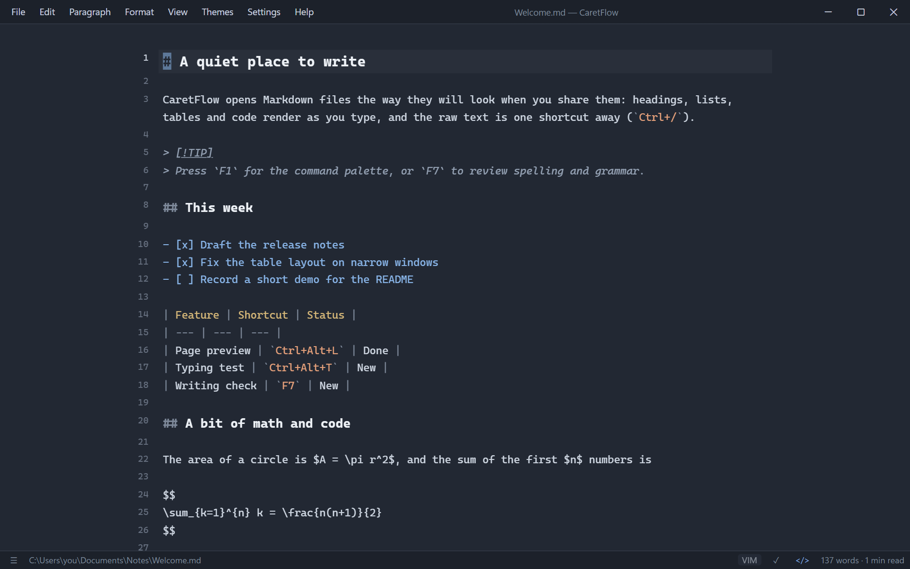
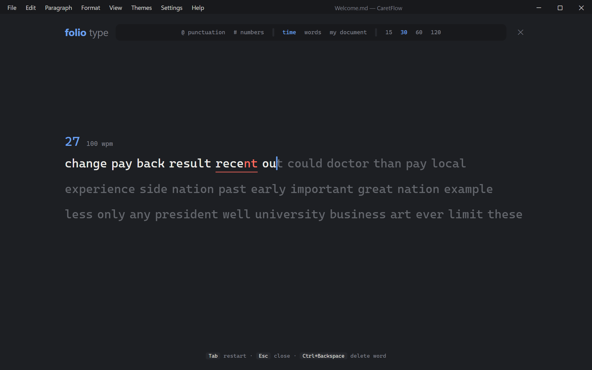
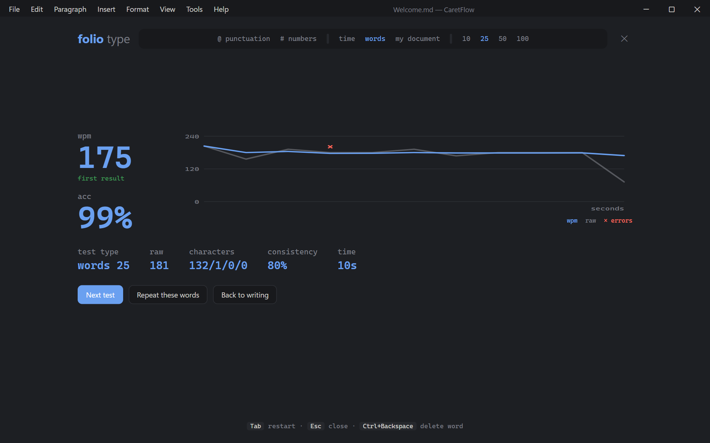
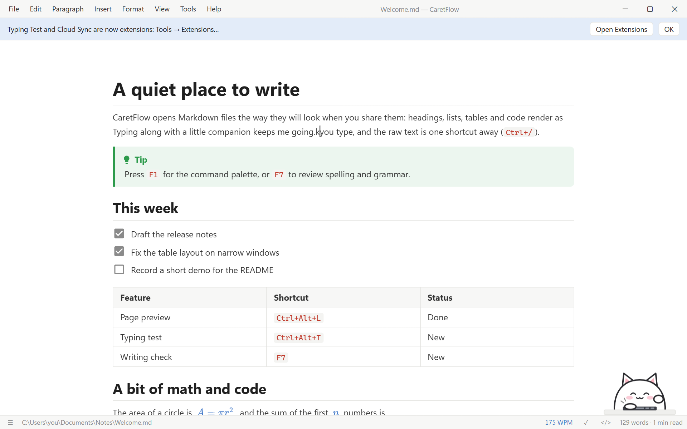

# CaretFlow


**A fast, quiet Markdown editor for Windows and Linux.** You write, CaretFlow renders it in place:
no split preview, no clutter. Raw Markdown and Vim are one shortcut away, and a built-in spelling
and grammar checker catches mistakes like a word processor would.

CaretFlow was called **Folio** until 0.5.0. Updating keeps your settings; the Windows installer removes
the old Folio install.



<p align="center">
  <a href="https://github.com/Sooeeren/folio/releases/latest"><b>Download the latest release</b></a> ·
  <a href="#build">Build from source</a> ·
  <a href="#keyboard-shortcuts">Shortcuts</a>
</p>

Inspired by Typora. Built with Tauri 2 (Rust + the system webview), Milkdown/ProseMirror for live
editing and CodeMirror 6 for source mode.

## Highlights

- **What you see is what you write.** Headings, tables, task lists, math (KaTeX), Mermaid diagrams,
  callouts and code with syntax highlighting render as you type. `Ctrl+/` shows the raw Markdown.
- **Spelling & grammar, offline.** Red and blue underlines, right-click suggestions, an `F7` review
  panel and AutoCorrect. Nothing leaves your computer unless you choose LanguageTool for other languages.
- **Vim mode** for source editing, including visual block, macros, registers and `:w` / `:q`.
- **PDF export** with page preview, page breaks, headers, footers and page numbers; also from the
  command line.
- **Files and folders**: sidebar with outline, file tree and folder search; quick open (`Ctrl+P`);
  command palette (`F1`).
- **Four themes** (Paper, Sepia, Ink, Slate) plus custom CSS, focus, typewriter and zen modes.
- **Typing test** (`Ctrl+Alt+T`) and optional extras: a live WPM meter and a typing cat.

## Writing check

CaretFlow checks spelling and grammar as you type. Red wavy lines mark spelling, blue double lines
grammar (*their/they're*, *could of*, *a apple*, *I has*, repeated words), and amber dotted lines
optional style hints. Right-click a marked word to fix it, ignore it or add it to your dictionary.



Press `F7` to walk through every issue, like Word's Spelling & Grammar pane. Number keys pick a
suggestion, `Enter` applies the first one, and a clean document shows readability statistics.



| | |
| --- | --- |
| **Checker** | [Harper](https://writewithharper.com) by default: runs locally (WebAssembly), English in American, British, Canadian, Australian or Indian spelling. [LanguageTool](https://languagetool.org) optionally, for German, French, Spanish and 30+ more languages (public server or your own). |
| **Shortcuts** | `F7` review panel · `Alt+F7` next issue · right-click for suggestions |
| **AutoCorrect** | Fixes common typos while you type (*teh* → *the*, *dont* → *don't*, *i* → *I*). `Backspace` right after a fix undoes it. |
| **Markdown-aware** | Code, inline code, math, links and file names are skipped, in both the rendered and the source view. |
| **Settings** | Preferences → Writing: engine, language, style hints, custom dictionary, rules you turned off. |

## Looks

<table>
  <tr>
    <td></td>
    <td></td>
  </tr>
  <tr>
    <td align="center">Ink theme, outline sidebar</td>
    <td align="center">Source mode with Vim (<code>Ctrl+/</code>)</td>
  </tr>
</table>

## Typing test

`Ctrl+Alt+T` opens a minimal speed test: 15 to 120 seconds or 10 to 100 words, with optional
punctuation and numbers, or practice on the text of the document you have open. Results show
WPM, accuracy, raw speed, consistency and a per-second chart, and personal bests are kept.

<table>
  <tr>
    <td></td>
    <td></td>
  </tr>
</table>

While writing, **View → Typing Speed (WPM)** shows your speed in the status bar and
**View → Typing Cat** adds a small companion that taps along. Both are off by default.



## Build

```sh
npm install
npm run app:build:all     # Windows + Linux → release/windows, release/linux
npm run app:build         # Windows only (src-tauri/target/release/…)
npm run app:build:linux   # Linux only (via WSL from Windows)
npm run app:dev           # hot-reload dev mode
npm run screenshots       # regenerate docs/screenshots (needs Chrome or Edge)
```

Outputs:

| Platform | File | Notes |
| --- | --- | --- |
| Windows | `release/windows/CaretFlow_*_x64-setup.exe` | installer, registers `.md` files |
| Windows | `release/windows/CaretFlow-portable.exe` | runs without installing (needs WebView2, preinstalled on Win 10/11) |
| Linux | `release/linux/CaretFlow_*_amd64.AppImage` | portable: `chmod +x` and run |
| Linux | `release/linux/CaretFlow_*_amd64.deb` | `sudo apt install ./CaretFlow_*.deb` |
| Linux | `release/linux/caretflow-*.x86_64.rpm` | RHEL/Fedora/openSUSE: `sudo dnf install ./caretflow-*.rpm` |
| Linux | `caretflow-bin-*-x86_64.pkg.tar.zst` (releases only) | Arch/Manjaro: `sudo pacman -U ./caretflow-bin-*.pkg.tar.zst` |
| Linux | `release/linux/caretflow` | raw binary, needs `libwebkit2gtk-4.1` installed |

Releases are built by GitHub Actions: pushing a tag like `v0.4.0` runs
`.github/workflows/release.yml`, which builds all of the files above and attaches them to a draft release.
The Arch package is made from the `.deb` by `packaging/arch/PKGBUILD` (in an Arch container); the same
`PKGBUILD` can be published to the AUR as `caretflow-bin`. The `.deb` and `.rpm` are rebuilt by
`scripts/deb-repackage.sh` and `scripts/rpm-repackage.sh` as `caretflow` (Tauri would call them `caret-flow`);
they replace the packages of the Folio days (`folio`, and `folio-markdown` for the `.rpm`). The Windows
installer removes an old Folio install first (`src-tauri/windows/installer-hooks.nsh`).

### Signed updates

The in-app updater only installs files signed with CaretFlow's private key (the public key is in
`src-tauri/tauri.conf.json`). The key lives outside the repository in `~/.tauri/folio.key`; keep a
backup, since updates for existing installs can't be signed without it.

- **Local builds** (`npm run app:build:all`) sign automatically when that file exists and write
  `release/latest.json`, the manifest the app reads.
- **GitHub Actions** reads the key from the repository secret `TAURI_SIGNING_PRIVATE_KEY` (contents
  of the key file; set with `gh secret set TAURI_SIGNING_PRIVATE_KEY < ~/.tauri/folio.key`). A key
  with a password also needs `TAURI_SIGNING_PRIVATE_KEY_PASSWORD`; the current key has none. The
  workflow then adds `latest.json` (which contains the signatures) to the release.
- Installed copies see a release once it is **published** (drafts and pre-releases are ignored, since
  the app reads `releases/latest/download/latest.json`). Write the release notes before tagging, or
  run the workflow again from the Actions tab afterwards, so the update popup can show them.

### Linux prerequisites (one time)

From Windows, the Linux build runs inside WSL (default distro `Ubuntu`; pass `-Distro <name>` to
`scripts/build-all.ps1` for another). On a fresh distro / Linux machine:

```sh
sudo bash scripts/linux-setup.sh     # apt deps (webkit2gtk 4.1 etc.) + Rust + Node 22 for your user
bash scripts/build-linux.sh          # on native Linux
```

## Keyboard shortcuts

`Shift+F1` lists every shortcut, `F1` opens the command palette. Every menu command can get a
different shortcut (or none) in **Preferences → Keyboard** (Help → Customize Shortcuts…). The
defaults most used:

| Action | Keys | Action | Keys |
| --- | --- | --- | --- |
| Source mode | `Ctrl+/` | Spelling & grammar | `F7` / `Alt+F7` |
| Quick open | `Ctrl+P` | Find / replace | `Ctrl+F` / `Ctrl+H` |
| Command palette | `F1` | Page preview | `Ctrl+Alt+L` |
| Sidebar | `Ctrl+Shift+L` | Export PDF | `Ctrl+Alt+E` |
| Focus / typewriter | `F8` / `F9` | Typing test | `Ctrl+Alt+T` |
| Vim keybindings | `Ctrl+Alt+V` | Page break | `Ctrl+Enter` |

## More features

- **Vim mode** (`Ctrl+Alt+V`) works in source mode (`Ctrl+/`): normal, insert, visual and visual-block
  modes, motions, operators, registers, marks, macros, `/` search, `:s`, and commands like `:w`, `:q`,
  `:e` and `:pre` (back to the rendered view). `Ctrl+A` / `Ctrl+X` and `g Ctrl+A` work on selections.
  Turn on **Open Files in Source Mode** to always edit that way. Vim mode shows line numbers (optionally
  relative, like `:set relativenumber`; without Vim, every fifth line can be numbered: Settings → Line
  Numbers), and CaretFlow starts in source mode again when you quit there.
- **PDF export** (`Ctrl+Alt+E`) writes the file directly, no print dialog: paper size, orientation,
  margins, page numbers, header and footer (`{title}` `{file}` `{date}` `{author}`) and document
  properties. **File → Print…** still opens the system dialog.
- **Page preview** (`Ctrl+Alt+L`) shows the real PDF next to the editor, refreshed as you type. Page
  breaks (`Ctrl+Enter`) are stored as `<div style="page-break-after: always;"></div>`, which other
  Markdown tools understand too.
- **Callouts** are GitHub-style alerts (`> [!NOTE]`, `TIP`, `IMPORTANT`, `WARNING`, `CAUTION`) shown as
  colored boxes in the editor and in exports (Paragraph → Callout).
- **Updates**: CaretFlow can check GitHub for a new version when it starts (it asks once; Preferences →
  Check for updates automatically, or Help → Check for Updates…). **Update & Restart** downloads the
  new version, verifies its signature, installs it and opens CaretFlow again. This works for the Windows
  installer, the AppImage, `.deb` and `.rpm`; `CaretFlow-portable.exe`, the raw binary, the Arch package
  (updated by pacman) and the `.rpm` on systems whose `rpm` only installs GPG-signed packages (Fedora 43
  and later; update with `dnf`) get a download link.
- **Command line export**, no window shown:
  `caretflow --export-pdf notes.md notes.pdf --paper letter --landscape` (also `--header`, `--footer`,
  `--author`, `--page-numbers`) and `caretflow --export-html notes.md notes.html`.

## Notes

- **Underline** (`Ctrl+U`, or the selection toolbar) is saved as `<u>text</u>`, since Markdown has no underline syntax.
- **Tables**: inserting asks for the size; press `Enter` in the last row or use the **+** buttons to grow it.
- **Mermaid**: Paragraph → Mermaid Diagram… (`Ctrl+Shift+D`) opens a template gallery.
- **Title bar**: CaretFlow draws its own (menus and window buttons in one row) on Windows and Linux.
  Settings → Use System Title Bar switches back (on Linux this applies after a restart).
- **Linux**: uses the desktop's native (xdg-portal) file dialogs, and sets
  `WEBKIT_DISABLE_DMABUF_RENDERER=1` (unless you set it yourself) to avoid WebKitGTK freezes on Wayland.
- **Update checks** download only `latest.json` from GitHub, and only after you agree. No data is sent.
- **LanguageTool** sends the text being checked to the server you configure; the free public server
  allows about 20 checks a minute. Harper (the default) never sends anything.

## Layout

- `src/main.js` – app: editor, files, find/replace, outline, palette, menus, shortcuts, settings
- `src/writing.js` – spelling & grammar UI for both editors (underlines, menu, F7 panel, dictionary)
- `src/writing-engine.js` – checker engines: Harper (WebAssembly worker) and LanguageTool (lazy-loaded)
- `src/autocorrect.js` – AutoCorrect while typing
- `src/typingtest.js` – typing test (lazy-loaded); `src/companion.js` – WPM meter and typing cat
- `src/source.js` – source-code mode + Vim (lazy-loaded)
- `src/export.js` – HTML export / print-to-PDF (lazy-loaded)
- `src/updater.js` – update check, download, install and restart (lazy-loaded)
- `src/blocks.js`, `src/underline.js` – page breaks, callouts, underline
- `src/style.css` – themes (Paper, Sepia, Ink, Slate) and typography
- `src-tauri/src/lib.rs` – file I/O commands (atomic save, folder listing, folder search); `pdf.rs` – PDF stamping
- `scripts/` – build scripts, AI line statistics, README screenshots

Errors are logged to `%TEMP%\caretflow.log` (`/tmp/caretflow.log` on Linux).

## Made with AI

CaretFlow is written almost entirely by AI coding assistants, steered and tested by its maintainer.
**Help → About CaretFlow** shows how many lines each model wrote, counted from the git history.

Working on CaretFlow with an AI assistant? Start with [AGENTS.md](AGENTS.md): it explains the project,
its goals and conventions, and how to credit the model in commits.
