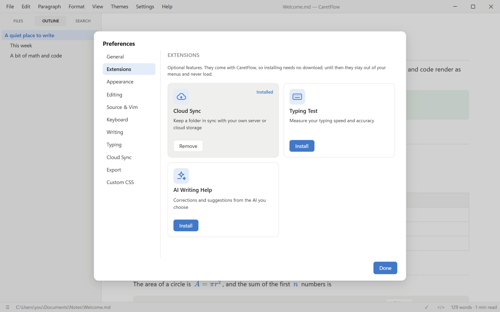

# CaretFlow

**A fast, quiet Markdown editor for Windows, Linux and Android.** You write, CaretFlow renders it in place:
no split preview, no clutter. Raw Markdown and Vim are one shortcut away, and a built-in spelling
and grammar checker catches mistakes as you type.

  <a href="https://github.com/Sooeeren/CaretFlow/releases/latest"><b>Download the latest release</b></a> ·
  <a href="#install">Install</a> ·
  <a href="docs/SHORTCUTS.md">Shortcuts</a> ·
  <a href="#documentation">Documentation</a>

Built with Tauri 2 (Rust + the system webview), Milkdown/ProseMirror for live
editing and CodeMirror 6 for source mode.

## Install

Pick a file from the [latest release](https://github.com/Sooeeren/CaretFlow/releases/latest):

| Platform | File | How |
| --- | --- | --- |
| Windows | `CaretFlow_*_x64-setup.exe` | Installer; registers `.md` files |
| Windows | `CaretFlow-portable.exe` | Runs without installing (needs WebView2, preinstalled on Windows 10/11) |
| Linux (any) | `CaretFlow_*_amd64.AppImage` | `chmod +x` and run |
| Debian / Ubuntu | `CaretFlow_*_amd64.deb` | `sudo apt install ./CaretFlow_*.deb` |
| Fedora / RHEL / openSUSE | `caretflow-*.x86_64.rpm` | `sudo dnf install ./caretflow-*.rpm` |
| Arch / Manjaro | `caretflow-bin-*-x86_64.pkg.tar.zst` | `sudo pacman -U ./caretflow-bin-*.pkg.tar.zst` |
| Android 7+ | `CaretFlow-*.apk` | Open it on the phone; see [docs/ANDROID.md](docs/ANDROID.md) |

The Windows installer, AppImage, `.deb` and `.rpm` update themselves from inside the app; on Android,
CaretFlow offers the new APK. To build
CaretFlow yourself, see [docs/BUILDING.md](docs/BUILDING.md).

## How is CaretFlow different?

CaretFlow sits closest to [Typora](https://typora.io): you write in the rendered document, and the raw
Markdown is one shortcut away. The differences are in what it is built around.

- **Compared with Typora**, CaretFlow is open source (MIT), and spelling and grammar checking, Vim
  mode and PDF export with page preview are built in.
- **Compared with Obsidian**, it is a file editor, not a knowledge base: you open a file or a folder
  and write, with no vault, plugins or linking features to set up.
- **Compared with MarkText and Zettlr**, which are Electron apps, CaretFlow uses Tauri and the system
  webview, so it is a small download that starts quickly. Zettlr aims at academic writing with
  citations; CaretFlow aims at general writing with a Word-style writing check.
- **Private by default**: no telemetry, and no network access unless you turn on LanguageTool, update
  checks or Cloud Sync.

Other apps change over time, so check their sites for their current features.

**Platforms:** Windows, Linux and Android (phones and tablets, with a touch layout). There is no macOS build and none is planned right now, but it is
not ruled out. Tauri supports macOS, so it depends on someone being able to build and test it.

## Highlights

- **What you see is what you write.** Headings, tables, task lists, math (KaTeX), Mermaid diagrams,
  callouts, front matter, a table of contents, HTML and code with syntax highlighting render as you type. `Ctrl+/` shows the raw Markdown.
- **Spelling & grammar, offline.** Red and blue underlines, right-click suggestions, an `F7` review
  panel and AutoCorrect. Nothing leaves your computer unless you choose LanguageTool for other languages.
- **Vim mode** for source editing, including visual block, macros, registers and `:w` / `:q`.
- **PDF export** with page preview, page breaks, headers, footers and page numbers; also from the
  command line.
- **Files and folders**: sidebar with outline, file tree and folder search; quick open (`Ctrl+P`);
  command palette (`F1`).
- **Four themes** (Paper, Sepia, Ink, Slate) plus custom CSS, focus, typewriter and zen modes, and an
  optional **Material You style** (View → Theme) with colors made from one color, or from your
  wallpaper on Android 12+.
- **Extensions you add when you want them**: Cloud Sync with your own server, AI writing help with
  the AI you choose, a typing test, and your writing status on Discord. Until installed they stay
  out of your menus.
- **Optional extras**: a live WPM meter and a typing cat (View menu).

## Writing check

CaretFlow checks spelling and grammar as you type. Red wavy lines mark spelling, blue double lines
grammar (*their/they're*, *could of*, *a apple*, *I has*, repeated words), and amber dotted lines
optional style hints. Right-click a marked word to fix it, ignore it or add it to your dictionary.

Press `F7` to walk through every issue one by one in a review panel. Number keys pick a
suggestion, `Enter` applies the first one, and a clean document shows readability statistics.

The checker is [Harper](https://writewithharper.com), which runs on your computer (English). Paragraphs
in other languages get that language's spelling dictionary, downloaded once and offline after that.
For grammar in 30+ languages there is [LanguageTool](https://languagetool.org): its public server, or
free and without limits on your own computer with the **Advanced Grammar** extension
([docs/LANGUAGETOOL.md](docs/LANGUAGETOOL.md)). The **AI Writing Help**
extension adds corrections and suggestions from the AI you choose. More in
[docs/FEATURES.md](docs/FEATURES.md#writing-check).

## Looks

<table>
  <tr>
    <td></td>
    <td></td>
  </tr>
  <tr>
    <td align="center">Ink theme, outline sidebar</td>
    <td align="center">Source mode with Vim (<code>Ctrl+/</code>)</td>
  </tr>
</table>

## Typing cat and WPM meter

**Tools → Typing Speed (WPM)** shows your speed in the status bar and **Tools → Typing Cat** adds a
small companion that taps along while you write. Both are off by default.

## Extensions

Bigger features come as extensions: they ship with CaretFlow, and you install them with one click
in **Preferences → Extensions** (Tools → Extensions…). Until then they add no menus, tabs or
settings, and their code never loads. Removing one keeps its settings.

| Extension | What it does |
| --- | --- |
| **Cloud Sync** | Keeps a folder in sync with storage **you** choose: WebDAV (Nextcloud, NAS…), S3-compatible (B2, R2, MinIO, AWS), or Google Drive, Proton Drive and others through [rclone](https://rclone.org). A Cloud tab in the sidebar shows every file and its sync state. [Setup](docs/CLOUD-SYNC.md) |
| **AI Writing Help** | Spelling, grammar and style suggestions from Claude, ChatGPT, Gemini, DeepSeek and others with your API key, or a model on your computer (Ollama, LM Studio), with limits you set. Or connect Claude Desktop, Cursor or VS Code over **MCP** to review your document. Nothing changes until you click Apply. [Details](docs/AI.md) · [MCP setup](docs/MCP.md) |
| **Typing Test** | A minimal speed test by time or word count, or on your own document, with WPM, accuracy and a per-second chart. [Details](docs/FEATURES.md#typing-test-and-extras) |
| **Advanced Grammar** | LanguageTool's full grammar and style checking for 30+ languages, running on your computer: no request limits, and your text stays there. Downloads LanguageTool and Java once (about 300 MB), starts in the background when you write, and optionally adds n-gram data that catches *their/there*. Windows and Linux. [Details](docs/LANGUAGETOOL.md) |
| **Discord Status** | Shows the CaretFlow logo on your Discord profile with what you are doing (writing or reading), the word count, source mode or Vim and how long you've been at it. The file name stays private unless you turn it on. Windows and Linux. [Details](docs/FEATURES.md#discord-status) |

CaretFlow has no servers or accounts of its own: Cloud Sync and AI Writing Help only talk to the
services you set up, and only once you turn them on.

## Documentation

| | |
| --- | --- |
| [Keyboard shortcuts](docs/SHORTCUTS.md) | Every default shortcut, by menu |
| [Features in detail](docs/FEATURES.md) | Writing check, Vim, PDF export and preview, callouts, updates, command line |
| [Extensions](docs/EXTENSIONS.md) | Installing and removing extensions, what each one adds |
| [Cloud Sync](docs/CLOUD-SYNC.md) | Setting up WebDAV, S3 and rclone; how syncing works |
| [AI Writing Help](docs/AI.md) · [MCP setup](docs/MCP.md) | Providers and keys, local models, every setting and limit; connecting your AI app |
| [Android](docs/ANDROID.md) | Installing, files and folders, the touch layout, what differs from the desktop |
| [Notes](docs/NOTES.md) | Privacy and network access, platform notes, where files are stored |
| [Privacy Policy](docs/PRIVACY.md) · [Terms of Service](docs/TERMS.md) | What is sent where, and the terms for the app, its extensions and the website |
| [Building](docs/BUILDING.md) · [Releasing](docs/RELEASING.md) | For developers |

In the app, **Help → Markdown Guide** shows the Markdown syntax and **Shift+F1** all shortcuts.

## Made with AI

CaretFlow is written almost entirely by AI coding assistants, steered and tested by its maintainer.
**Help → About CaretFlow** shows how many lines each model wrote, counted from the git history.

Working on CaretFlow with an AI assistant? Start with [AGENTS.md](AGENTS.md): it explains the project,
its goals and conventions, and how to credit the model in commits.
