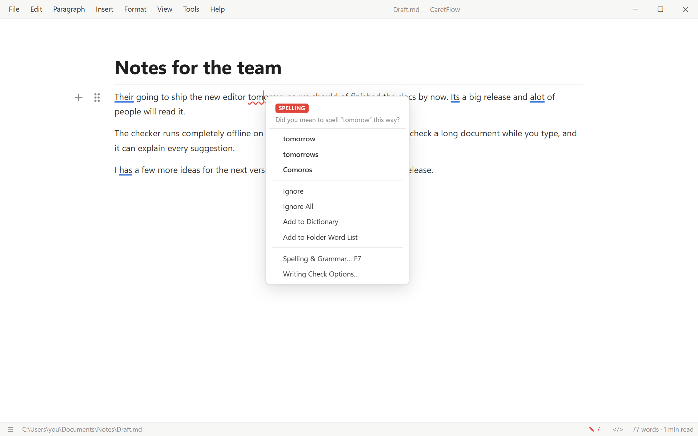
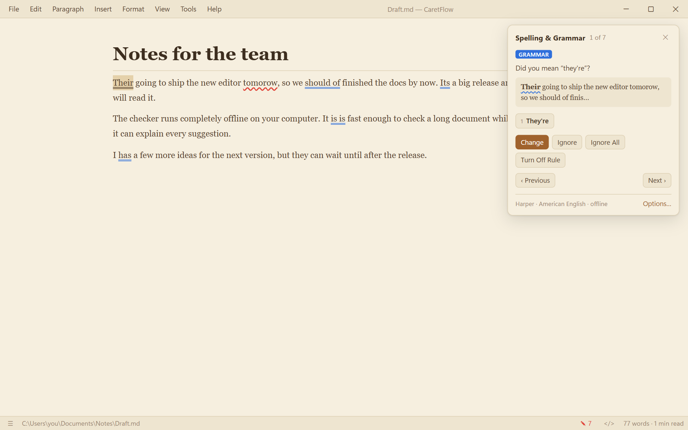
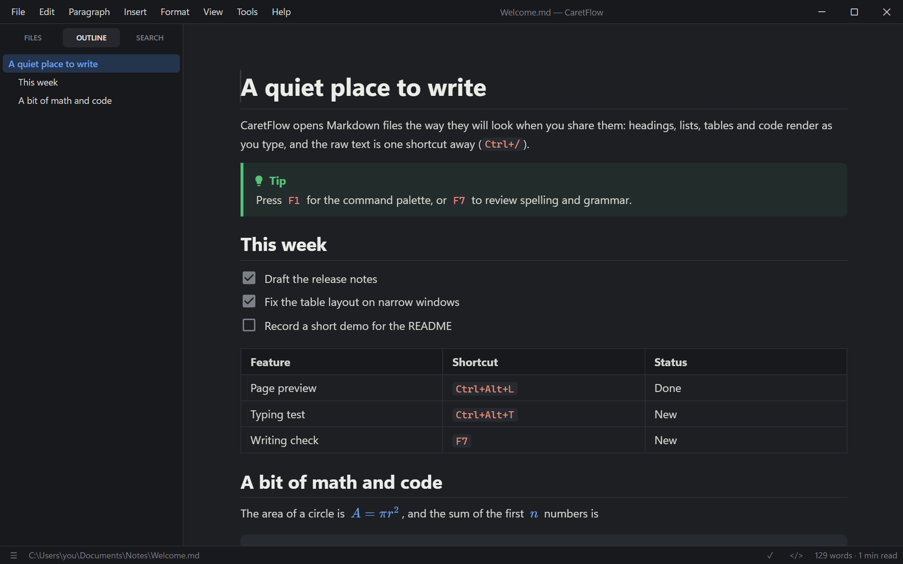
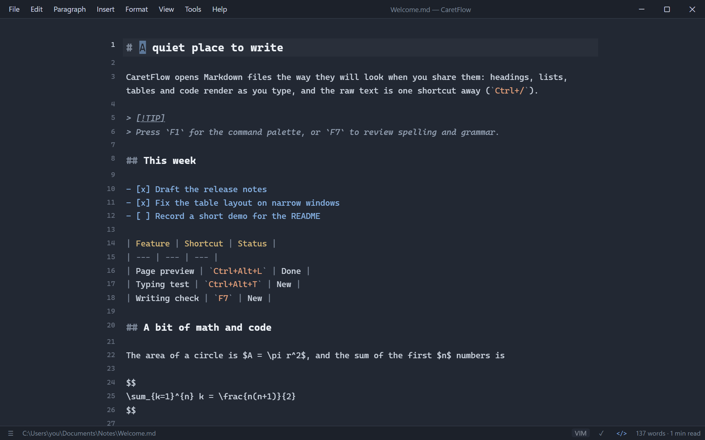

# CaretFlow

**The all-in-one Markdown editor.** Fast, quiet and minimal on the surface, with everything you
need underneath: live rendered editing, spelling and grammar, Vim, and export to PDF, Word and
EPUB. For Windows, Linux and Android. Open source, private by default.

  <a href="https://github.com/Sooeeren/CaretFlow/releases/latest"><b>Download</b></a> ·
  <a href="#install">Install</a> ·
  <a href="docs/FEATURES.md">Features</a> ·
  <a href="docs/SHORTCUTS.md">Shortcuts</a>

## What's inside

- **Write in the rendered document.** Tables, math, Mermaid, callouts and code render as you type; `Ctrl+/` shows the raw Markdown.
- **Spelling & grammar, offline.** Underlines, right-click fixes and an `F7` review panel, in many languages.
- **Vim mode** in source view, with visual block, macros and `:w`.
- **Export** to PDF (with page preview), Word, OpenDocument, EPUB, LaTeX and HTML.
- **Files and folders**: file tree, outline, folder search, quick open (`Ctrl+P`), command palette (`F1`).
- **Yours to shape**: themes and a theme editor, Material You, custom shortcuts and menus, searchable preferences.
- **Extensions** when you want them: Cloud Sync, AI Writing Help, a typing test, Discord status and offline LanguageTool.

<table>
  <tr>
    <td></td>
    <td></td>
  </tr>
  <tr>
    <td></td>
    <td></td>
  </tr>
  <tr>
    <td></td>
    <td></td>
  </tr>
</table>

## Install

Pick a file from the [latest release](https://github.com/Sooeeren/CaretFlow/releases/latest):

| Platform | File |
| --- | --- |
| Windows | `CaretFlow_*_x64-setup.exe` (installer) or `CaretFlow-portable.exe` |
| Linux | `.AppImage`, `.deb`, `.rpm` or the Arch package `caretflow-bin` |
| Android 7+ | `CaretFlow-*.apk` ([details](docs/ANDROID.md)) |

CaretFlow updates itself from inside the app. To build it yourself, see [docs/BUILDING.md](docs/BUILDING.md).

## Documentation

[Features](docs/FEATURES.md) · [Shortcuts](docs/SHORTCUTS.md) · [Extensions](docs/EXTENSIONS.md) ·
[Cloud Sync](docs/CLOUD-SYNC.md) · [AI](docs/AI.md) · [MCP](docs/MCP.md) · [Android](docs/ANDROID.md) ·
[Notes](docs/NOTES.md) · [Privacy](docs/PRIVACY.md) · [Terms](docs/TERMS.md) · [Building](docs/BUILDING.md)

## Made with AI

CaretFlow is written almost entirely by AI coding assistants, steered and tested by its maintainer;
**Help → About** shows how many lines each model wrote. Working on it with an AI assistant? Start
with [AGENTS.md](AGENTS.md).
