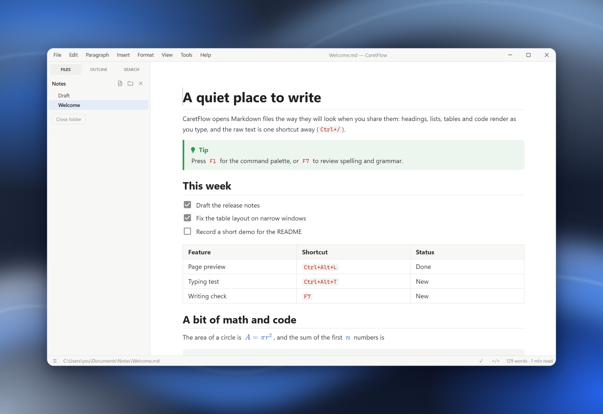
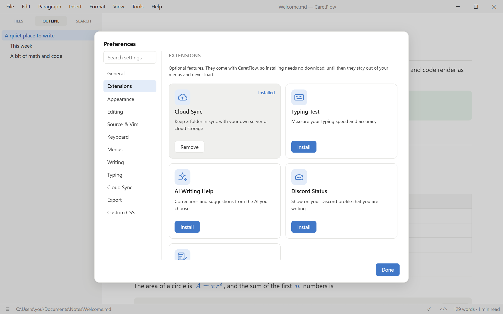
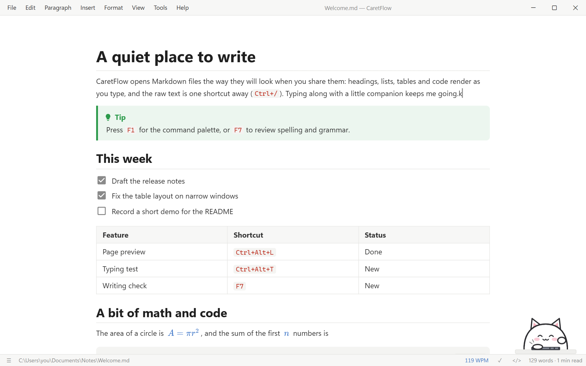

# CaretFlow


**The all-in-one Markdown editor.** Fast, quiet and minimal on the surface, with everything you
need underneath: live rendered editing, a Word-quality spelling and grammar checker, Vim, and
export to PDF, Word and EPUB. For Windows, Linux and Android. Open source, private by default.

<br>



<p align="center">
  <a href="https://github.com/Sooeeren/CaretFlow/releases/latest"><b>Download</b></a> ·
  <a href="#install">Install</a> ·
  <a href="docs/FEATURES.md">Features</a> ·
  <a href="docs/SHORTCUTS.md">Shortcuts</a> ·
  <a href="#documentation">Documentation</a>
</p>

<p align="center">
  <a href="https://github.com/Sooeeren/CaretFlow/releases/latest"></a>
  <a href="https://github.com/Sooeeren/CaretFlow/releases"></a>
  <a href="LICENSE"></a>
  
</p>

## Why CaretFlow

CaretFlow opens Markdown files the way they will look when you share them. Headings, lists,
tables, math and code render as you type, and the raw text is always one shortcut away
(`Ctrl+/`). There is no split preview to keep in sync and nothing to set up: open a file or a
folder and write.

It is built around a few simple ideas:

- **Writing comes first.** Typing never waits for anything. Spell checking, exports and other heavy
  work run in the background or load only when you first use them.
- **Private by default.** No accounts, no telemetry, and no network access unless you turn on a
  feature that needs it, such as update checks, LanguageTool or Cloud Sync.
- **Plain Markdown files.** What CaretFlow writes stays readable in any other editor, on GitHub and
  in static site generators. Extras use conventions other tools already know.
- **Keyboard first.** Every command has a menu entry, a shortcut you can change, and a place in the
  command palette (`F1`).

## Features

### Editing

- **Live rendered editing** of headings, lists, task lists, tables, quotes, links and images.
- **Math** with KaTeX, **Mermaid diagrams** with a gallery of starting points, **callouts**
  (`> [!NOTE]`), **front matter** as a properties panel, and a live **table of contents** (`[TOC]`).
- **Code blocks** with syntax highlighting for dozens of languages, line numbers and one-click copy.
- **Source mode** (`Ctrl+/`) with syntax colors, and optional **Vim keybindings**: visual block,
  macros, registers, `:w`, `:q` and more.
- **Images** pasted or dropped from anywhere: copied to `./assets`, a folder of your choice, or
  embedded. Resize them like in Typora, and view them full screen.
- **Focus, typewriter and zen modes**, plus a reader mode for files you only want to read.

### Spelling and grammar

CaretFlow checks your writing as you type, the way a word processor does. Red lines mark spelling,
blue lines grammar (*their/they're*, *could of*, *a apple*, repeated words) and amber lines
optional style hints. Right-click a marked word to fix it, ignore it, or add it to your
dictionary, and press `F7` to walk through every issue in a review panel.

The checker is [Harper](https://writewithharper.com), which runs entirely on your computer.
Paragraphs in other languages are detected and checked with that language's dictionary,
downloaded once. For grammar in 30+ languages, use [LanguageTool](https://languagetool.org): its
public server, or offline on your own computer with the **Advanced Grammar** extension.

<table>
  <tr>
    <td></td>
    <td></td>
  </tr>
  <tr>
    <td align="center">Right-click suggestions</td>
    <td align="center">The <code>F7</code> review panel</td>
  </tr>
</table>

### Export and print

- **PDF** with a live page preview, page size and margins, headers, footers, page numbers and page
  breaks (`Ctrl+Enter`). Also available from the command line.
- **Word (.docx)** with Word's own styles, editable equations and embedded images.
- **OpenDocument, EPUB, LaTeX, HTML and plain text**, all made on your computer, offline.

### Files and folders

- A sidebar with a **file tree**, an **outline** of the document and **search across the folder**.
- **Quick open** (`Ctrl+P`), recent files, multiple windows, and auto-save if you want it.
- Files changed by another program are reloaded, or you are asked when you have unsaved edits.

### Make it yours

- Four built-in themes (Paper, Sepia, Ink, Slate), **your own themes** from a color editor, and an
  optional **Material You** style made from one color (or your wallpaper on Android 12+).
- **Custom shortcuts** for every command, and **menus you arrange yourself** by drag and drop, or
  from templates for writers, students, developers and note-takers.
- **Searchable preferences**, custom CSS, fonts, line height, content width and more.

<table>
  <tr>
    <td></td>
    <td></td>
  </tr>
  <tr>
    <td align="center">Ink theme with the outline</td>
    <td align="center">Source mode with Vim</td>
  </tr>
</table>

## Extensions

Bigger features come as extensions. They ship with CaretFlow and install with one click in
**Preferences → Extensions**; until then they add no menus or settings and their code never
loads.

| Extension | What it does |
| --- | --- |
| **Cloud Sync** | Keeps a folder in sync with storage you choose: WebDAV (Nextcloud, a NAS), S3-compatible services, or Google Drive and Proton Drive through rclone. [Setup](docs/CLOUD-SYNC.md) |
| **AI Writing Help** | Spelling, grammar and style suggestions from the AI you choose, with your own API key or a local model, and limits you set. Also connects to AI apps over MCP. [Details](docs/AI.md) |
| **Advanced Grammar** | LanguageTool on your computer: full grammar checking in 30+ languages, with no limits and no text leaving your machine. [Details](docs/LANGUAGETOOL.md) |
| **Typing Test** | A speed test by time, word count or on your own document, with WPM, accuracy and a chart. |
| **Discord Status** | Shows what you are writing (or just that you are) on your Discord profile. |

<table>
  <tr>
    <td></td>
    <td></td>
  </tr>
  <tr>
    <td align="center">Preferences → Extensions</td>
    <td align="center">Optional extras: a WPM meter and a typing cat</td>
  </tr>
</table>

## Install

Download a file from the [latest release](https://github.com/Sooeeren/CaretFlow/releases/latest):

| Platform | File | How |
| --- | --- | --- |
| Windows 10/11 | `CaretFlow_*_x64-setup.exe` | Installer; registers `.md` files and updates itself |
| Windows 10/11 | `CaretFlow-portable.exe` | Runs without installing |
| Linux (any) | `CaretFlow_*_amd64.AppImage` | `chmod +x` and run |
| Debian / Ubuntu | `CaretFlow_*_amd64.deb` | `sudo apt install ./CaretFlow_*.deb` |
| Fedora / RHEL / openSUSE | `caretflow-*.x86_64.rpm` | `sudo dnf install ./caretflow-*.rpm` |
| Arch / Manjaro | `caretflow-bin-*-x86_64.pkg.tar.zst` | `sudo pacman -U ./caretflow-bin-*.pkg.tar.zst` |
| Android 7+ | `CaretFlow-*.apk` | Open it on the phone ([details](docs/ANDROID.md)) |

The Windows installer, AppImage and `.deb` update themselves from inside the app; on Android,
CaretFlow offers the new APK. The Linux packages register CaretFlow for Markdown files, so it
shows up under "Open with".

There is no macOS build at the moment. Tauri supports macOS, so it may come once it can be built
and tested there.

## Documentation

| | |
| --- | --- |
| [Features in detail](docs/FEATURES.md) | Writing check, Vim, exports and page preview, images, callouts, updates, command line |
| [Keyboard shortcuts](docs/SHORTCUTS.md) | Every default shortcut, by menu |
| [Extensions](docs/EXTENSIONS.md) | Installing and removing extensions, what each one adds |
| [Cloud Sync](docs/CLOUD-SYNC.md) | WebDAV, S3 and rclone setup; how syncing works |
| [AI Writing Help](docs/AI.md) · [MCP](docs/MCP.md) | Providers, keys and local models; connecting your AI app |
| [Android](docs/ANDROID.md) | Installing, files and folders, the touch layout |
| [Notes](docs/NOTES.md) | Privacy and network access, platform notes, where files are stored |
| [Privacy Policy](docs/PRIVACY.md) · [Terms](docs/TERMS.md) | What is sent where, and the terms of use |

In the app, **Help → Markdown Guide** explains the Markdown syntax and `Shift+F1` lists all shortcuts.

## Building from source

CaretFlow is a [Tauri 2](https://tauri.app) app: a Rust backend for files and PDF work, and a plain
JavaScript frontend built with Vite, using [Milkdown](https://milkdown.dev)/ProseMirror for the
rendered view and [CodeMirror 6](https://codemirror.net) for source mode.

```sh
npm install
npm run app:dev      # the app with hot reload (needs Rust)
npm run app:build    # a release build for this platform
```

See [docs/BUILDING.md](docs/BUILDING.md) for the requirements on each platform and
[docs/RELEASING.md](docs/RELEASING.md) for how releases are made.

## Contributing

Bug reports and feature ideas are welcome in the
[issue tracker](https://github.com/Sooeeren/CaretFlow/issues/new/choose). Pull requests are too:
keep them focused on one change, and run `npx vite build` and the UI checks in `scripts/checks/`
before sending one.

CaretFlow is written almost entirely by AI coding assistants, steered and tested by its maintainer.
**Help → About** shows how many lines each model wrote, counted from the git history. If you work
on it with an AI assistant, start with [AGENTS.md](AGENTS.md): it explains the project, its goals
and conventions, and how to credit the model in commits.

## License

[MIT](LICENSE) © Sooeeren
