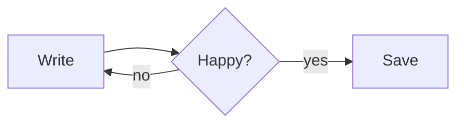
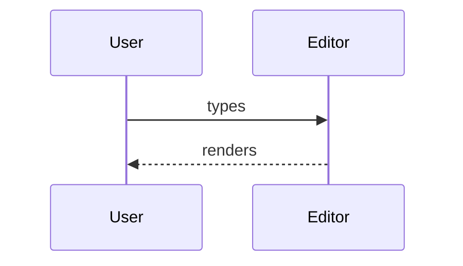
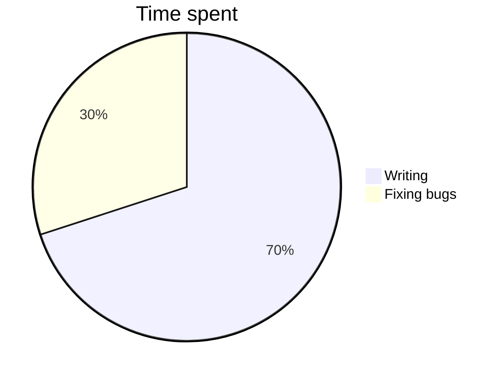
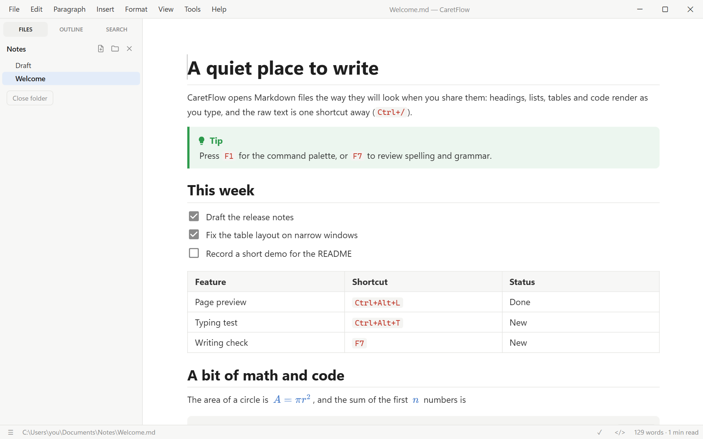

# CaretFlow Benchmark

A test document for every feature of the editor. Work through it top to bottom. Each section has
the **content to test** and a **checklist** of things to try: tick the boxes as you go (that also
tests task lists). **Save a copy first** (`Ctrl+Shift+S`) so the original stays clean, and open the
whole `benchmark` folder (`Ctrl+Shift+O`) so the folder features work.

How to report: note the section number, theme, platform (Windows / Linux / Android), and whether it
happens in the rendered view, source mode, or both.

[TOC]

## 0. Before you start

- [ ] Opened the `benchmark` folder, not just this file
- [ ] Noted version (Help → About), platform and theme
- [ ] **Round trip baseline:** type one character at the end, delete it, save, and run
      `git diff benchmark/`. Expected rewrites (known, not bugs): padded table columns, setext
      headings become `#`, all rules become one style, reference links become inline links, list
      continuation lines lose their extra indent, unneeded escapes are dropped. **Any change to
      the content itself is a round-trip bug.**

## 1. Front matter

The properties panel above should show title, author, date, a `tags` list as chips and `draft`.

- [ ] Panel shows all six keys; `tags` shows three chips
- [ ] Click the panel → YAML editor opens; `Escape` cancels without changes
- [ ] Edit a value, `Ctrl+Enter` finishes; the panel updates
- [ ] Select the panel with the arrow keys and press `Enter` → editor opens
- [ ] The word *Benchmarkword* is **not** underlined (from `spellcheck-words`)
- [ ] Front matter is **left out** of PDF / HTML / Word exports, but title and author fill the
      document properties (and the title page in Word / ODT / EPUB)
- [ ] Insert → Front Matter (`Ctrl+Alt+F`) in a new document adds one; here it should do nothing
      harmful

## 2. Table of contents

The `[TOC]` line above shows every heading of this document.

- [ ] All headings are listed, nested by level
- [ ] Clicking an entry scrolls to that heading
- [ ] Rename this heading → the TOC updates as you type
- [ ] In the HTML and PDF export, the entries are working links
- [ ] Insert → Table of Contents (`Ctrl+Alt+O`) inserts another `[TOC]`; delete it again

## 3. Headings

# Heading level 1
## Heading level 2
### Heading level 3
#### Heading level 4
##### Heading level 5
###### Heading level 6

Setext heading (level 1)
========================

Setext heading (level 2)
------------------------

### Heading with **bold**, *italic*, `code` and a [link](https://example.com)

### A very long heading that goes on and on so that it must wrap onto a second line even in a wide window, to check its line height and spacing

- [ ] `Ctrl+1` … `Ctrl+6` turn the current paragraph into a heading; `Ctrl+0` back into a paragraph
- [ ] `Ctrl+=` / `Ctrl+-` promote / demote a heading
- [ ] Typing `## ` at the start of a line makes a heading
- [ ] Setext headings stay headings of the same level after saving (written back as `#`)
- [ ] The outline (`Ctrl+Shift+1`) lists all headings; clicking one jumps there
- [ ] The gap above the first heading stays steady when you click images further down

## 4. Inline formatting

Plain, **bold**, *italic*, ***bold italic***, ~~strikethrough~~, <u>underline</u>, `inline code`,
**bold with *nested italic* inside**, *italic with `code` inside*, ~~strike with **bold**~~.

Underscore variants: __bold__, _italic_, ___both___. Intra-word: snake_case_name stays plain,
but un*frigging*believable is italic in the middle.

Escapes: \*not italic\*, \`not code\`, \# not a heading, \[not a link\], 1\. not a list, a \| pipe,
a backslash \\ and a literal &amp; entity.

Line break with two trailing spaces  
next line. Line break with a backslash\
next line.

- [ ] `Ctrl+B`, `Ctrl+I`, `Ctrl+U`, `Alt+Shift+5`, ``Ctrl+Shift+` `` on a selection
- [ ] Each shortcut again toggles the format **off**
- [ ] `Ctrl+\` clears all formatting from a selection
- [ ] The selection toolbar appears and its buttons work
- [ ] Typing `**word**` and `*word*` converts as you type; `` `code` `` too
- [ ] Escapes above stay literal after a round trip through source mode
- [ ] Underline is saved as `<u>…</u>`
- [ ] Both hard line breaks survive save and reload
- [ ] **Copy as Markdown** (`Ctrl+Shift+C`) on a selection gives the Markdown text

## 5. Lists

- Bullet one
- Bullet two
  - Sub-point (hollow bullet, softer color, slightly smaller)
    - Sub-sub-point (square bullet)
      - Fourth level
- Bullet three with a long text that wraps onto the next line so you can check that the wrapped line
  lines up with the text and not with the bullet

* Star bullets (should stay `*` after editing — roundtrip check)
* Second star bullet

1. Ordered one
2. Ordered two
   1. Lettered (a, b, c)
      1. Roman (i, ii, iii)
   2. Second lettered
3. Ordered three

A paragraph in between, so the next list is a new list.

7. A list that starts at seven
8. Eight

- Loose list item one

- Loose list item two (blank line between items)

- [ ] Open task
- [x] Done task
- [ ] Task with **formatting** and a nested list:
  - [ ] Nested task
  - [x] Nested done task

Checklist:

- [ ] `Ctrl+Shift+[` / `Ctrl+Shift+]` / `Ctrl+Shift+X` turn a paragraph into a list
- [ ] `Tab` / `Shift+Tab` indent and outdent list items
- [ ] `Enter` on an empty item ends the list
- [ ] `*` bullets stay `*`, the list starting at 7 stays at 7 after editing
- [ ] Clicking a checkbox toggles it (and the file changes `[ ]` ↔ `[x]`)
- [ ] Turn off Preferences → Editing → Style sub-points differently: sub-points look like top level
- [ ] In the PDF export, sub-point spacing matches the editor

## 6. Blockquotes and callouts

> A simple quote.
> On two lines.
>
> > A nested quote.
>
> A quote with a list:
> - one
> - two

> [!NOTE]
> A note callout with **bold** text.

> [!TIP]
> A tip callout.

> [!IMPORTANT]
> An important callout.

> [!WARNING]
> A warning callout with `code` and a [link](https://example.com).

> [!CAUTION]
> A caution callout
> on several lines.
>
> With a second paragraph.

- [ ] All five callouts have their own color and icon, in all four themes
- [ ] Clicking the title line shows the `[!WARNING]` marker; you can change it to `[!TIP]`
- [ ] Paragraph → Callout turns a plain paragraph into a callout
- [ ] `Ctrl+Shift+Q` turns a paragraph into a quote and back
- [ ] Put a spelling mistake right after the marker (`> [!NOTE]` then *teh mistak*): the title is drawn
      **once**, not twice
- [ ] Callouts are colored boxes in PDF, HTML and Word exports

## 7. Code

Inline code at the start of a line (this once froze source mode):

`npm install` is the first command.

```js
// JavaScript
function greet(name) {
  const greeting = `Hello, ${name}!`
  return greeting.length > 10 ? greeting : null
}
```

```python
# Python
def fib(n: int) -> int:
    return n if n < 2 else fib(n - 1) + fib(n - 2)
```

```rust
// Rust
fn main() {
    let v: Vec<i32> = (1..=10).filter(|x| x % 2 == 0).collect();
    println!("{:?}", v);
}
```

```bash
#!/usr/bin/env bash
for f in *.md; do echo "$f"; done
```

```json
{ "name": "caretflow", "version": "0.14.0", "private": true, "list": [1, 2, 3] }
```

```css
body.material .cf-button { border-radius: 999px; color: var(--accent); }
```

```html
<div class="box"><p>Hello <b>world</b></p></div>
```

```sql
SELECT id, title FROM documents WHERE updated_at > NOW() - INTERVAL '1 day' ORDER BY title;
```

```diff
- removed line
+ added line
```

```
A code block without a language.
```

```js
const thisIsAVeryLongLineOfCodeThatShouldWrapOntoTheNextLineWhenWrapCodeLinesIsOnAndScrollSidewaysWhenItIsOff = true
```

```

```

- [ ] Every language is colored, in all four themes and in exports
- [ ] The language button and Copy never cover code; on hover they appear
- [ ] Copy puts the code (without the language) on the clipboard
- [ ] Change a block's language with the language button; its list stays inside the window
- [ ] The long line wraps; `Alt+Z` turns wrapping off → it scrolls sideways and the buttons move to a
      row of their own; `Alt+Z` again
- [ ] The empty code block above can be clicked into and typed in
- [ ] `Ctrl+Shift+K` inserts a code block; typing ```` ``` ```` + `Enter` too
- [ ] Code is **not** spell-checked: `teh` here → `const teh = 1` is not underlined
- [ ] `Tab` inside a code block indents, not leaves the block

## 8. Math

Inline: $e^{i\pi} + 1 = 0$, a fraction $\frac{a}{b}$, and a sum $\sum_{k=1}^{n} k = \frac{n(n+1)}{2}$.
A price of $5 and $10 should **not** become math.

$$
\int_0^\infty e^{-x^2}\,dx = \frac{\sqrt{\pi}}{2}
$$

$$
\begin{aligned}
  f(x) &= (x + 1)^2 \\
       &= x^2 + 2x + 1
\end{aligned}
$$

$$
A = \begin{pmatrix} 1 & 2 \\ 3 & 4 \end{pmatrix}, \quad \det A = -2
$$

$$
\invalidcommand{x}
$$

- [ ] All formulas render; the invalid one shows an error, not a blank or a crash
- [ ] Click a formula to edit its TeX; clicking away renders it again
- [ ] `Ctrl+Shift+E` inline math, `Ctrl+Shift+M` math block
- [ ] The dollar prices stay plain text
- [ ] Word export: equations are **editable Word equations**; EPUB: MathML; LaTeX: as written

## 9. Mermaid diagrams







```mermaid
graph TD
  this is not valid mermaid
```

- [ ] The three valid diagrams render, and follow light / dark themes
- [ ] The invalid one shows an error message, and you can still edit it
- [ ] `Ctrl+Shift+D` opens the template gallery; insert one
- [ ] With the Diagram Editor extension: **Diagram** on a diagram (or `Ctrl+Alt+D`, or a double-click
      on the drawing) opens it; add boxes, drag to connect, rename, undo, Done writes Mermaid code back
- [ ] Scroll far below the diagrams and back: they stay drawn, nothing jumps
- [ ] Diagrams appear in PDF, as images in Word, as SVG in EPUB

## 10. Tables

| Left | Center | Right | Default |
| :--- | :----: | ----: | ------- |
| a | b | c | d |
| **bold** | *italic* | `code` | [link](https://example.com) |
| a pipe \| inside | $x^2$ | 1,234.56 | <u>u</u> |
| a very long cell that should wrap inside the table instead of pushing it wider than the page | | | empty cells → |

| Single column |
| --- |
| one |

- [ ] Alignments show correctly (left, center, right)
- [ ] The escaped pipe stays a pipe and does not split the cell after saving
- [ ] `Enter` in the last row adds a row; the **+** buttons add rows and columns
- [ ] `Tab` moves to the next cell
- [ ] `Ctrl+T` asks for a size and inserts a table
- [ ] Delete a row / column via right-click
- [ ] The long cell wraps in the editor and in the PDF
- [ ] Word export uses a table style; plain-text export aligns columns; LaTeX uses `longtable`

## 11. Links

- External: [example.com](https://example.com)
- Autolink: <https://example.org> and a bare URL https://example.net
- Email: <mailto:someone@example.com>
- Relative file: [Second File](notes/Second%20File.md)
- Heading anchor: [jump to Tables](#10-tables)
- With title: [hover me](https://example.com "A link title")
- Reference style: [the reference link][ref] and [another one][]

[ref]: https://example.com/reference
[another one]: https://example.com/another

Footnote test: here is a sentence with a footnote.[^1] And another.[^note]

[^1]: The first footnote.
[^note]: A named footnote with **formatting**.

- [ ] `Ctrl+Click` opens links; a plain click only places the cursor and shows the link's popup,
      where a click on the address opens it
- [ ] In read-only mode (`Ctrl+Shift+R`) a plain click opens them
- [ ] The relative link opens `notes/Second File.md` inside CaretFlow
- [ ] The heading anchor scrolls to section 10
- [ ] Reference-style links still point to the right address after saving (they become inline links)
- [ ] Footnotes show as 1 and 2 (the named one too), notes below a rule; clicking a number jumps
      to the note and back; they survive saving
- [ ] `Ctrl+K` on a selection makes a link
- [ ] Links are not spell-checked: `https://exmaple.com/teh` is not underlined

## 12. Images

Relative image:


Wide screenshot (should scale to the window width):



Resized like Typora (50 %):


Fixed width in pixels:


Missing image (broken path):


Web image (left out of offline exports as a link):


- [ ] All local images show; the missing one shows a clear placeholder, not a layout jump
- [ ] Hover → full-screen button; arrow keys go through all images; `Esc` closes
- [ ] Right-click → sizes 10 %–200 % and Custom Size… (percent and pixels) work and save as
      `style="zoom:…"` / `width="…"`
- [ ] Click an image, then `Ctrl+Alt+=` / `Ctrl+Alt+-` / `Ctrl+Alt+0`
- [ ] Right-click → Edit Alt Text; the alt text is **kept** after saving
- [ ] View → Show Image Alt Text shows captions under every image
- [ ] Paste an image from the clipboard → it goes where Insert → When Adding Images says
      (try `./assets`, `./<file name>.assets`, Base64)
- [ ] Drag an image file in from the file manager
- [ ] Resized images keep their size in PDF, HTML, Word, ODT and LaTeX

## 13. HTML in Markdown

Keys: press <kbd>Ctrl</kbd>+<kbd>S</kbd>. Water is H<sub>2</sub>O, Einstein wrote E=mc<sup>2</sup>,
and <mark>this is highlighted</mark>.

<details>
<summary>Click to expand</summary>

Hidden content with **Markdown** inside.

</details>

<div align="center">

### Centered heading

Centered paragraph with **bold** text. It must stay editable as Markdown.

</div>

<div style="text-align: right; color: #c0392b;">

Right-aligned red paragraph.

</div>

<center>Old-style centered text</center>

<p align="center">
  
</p>

Sanitizer test — none of this may run or show a form (the HTML must stay in the file):

<script>alert('If you see this popup, scripts are NOT removed — bug!')</script>

<form><input type="text" value="A form should not be shown"></form>
<iframe src="https://example.com" width="200" height="50"></iframe>

- [ ] `<kbd>`, `<sub>`, `<sup>`, `<mark>`, `<details>` render
- [ ] The centered block shows centered and its Markdown is still editable; the tag lines are hidden
      (they show in source mode)
- [ ] **Click to expand** opens and closes the hidden paragraph; a double click edits the HTML
- [ ] The styled `div` is right-aligned and red
- [ ] **No alert pops up**, no form, no iframe — and source mode still shows them exactly as written
- [ ] Click an HTML block → edit it as source; `Ctrl+Enter` finishes, `Escape` cancels

## 14. Page breaks and rules

Text before the page break.

<div style="page-break-after: always;"></div>

Text after the page break (should start on a new page in the PDF and page preview).

Three kinds of horizontal rule (after an edit they all take the document's one rule style):

---

***

___

- [ ] `Ctrl+Enter` inserts a page break; it shows as a marker, not raw HTML
- [ ] Page preview (`Ctrl+Alt+L`) shows the break as a new page
- [ ] `Ctrl+Shift+H` inserts a rule
- [ ] After editing, all three rules are written in one style and still show as rules

## 15. Spelling and grammar

Spelling (red wavy): Thsi sentense has severl speling misteaks in it.

Grammar (blue double): Their going to ship it tomorrow, so we should of finished. I has a apple.
It is is a repeated word.

Style hints (amber dotted, if enabled): In order to utilize this, you should very really try it.

Case rules: caretflow should be CaretFlow. A word in ALL CAPS like ZORBLAX.

Folder word list (from `.caretflow-words`): Zorblax and flibbertigibbet are not underlined.

Front matter word list: Benchmarkword is not underlined.

German paragraph (detected as German, offered the German dictionary): Das ist ein kurzer Absatz auf
Deutsch, damit die Spracherkennung ihn nicht als englische Fehler markiert. Hier ist ein Feler.

French paragraph: Ceci est un court paragraphe en français pour tester la détection de la langue,
avec une faute: bonjoure.

Skipped by the checker: `teh wrng` in code, $\mathrm{teh}$ in math, [a link](https://exmaple.com/teh) whose
address is misspelled, a file name like `mispeled_file.md`.

- [ ] Each kind of issue has its own underline
- [ ] Right-click a mistake → suggestions, Ignore, Ignore All, Add to Dictionary, Add to Folder Word List
- [ ] **Ignore All** is remembered after closing and reopening this file
- [ ] `F7` opens the review panel; number keys pick a suggestion, `Enter` applies the first
- [ ] `Alt+F7` jumps to the next issue
- [ ] After fixing everything, the panel shows readability statistics
- [ ] The German / French paragraphs are not marked as English; their own typo (*Feler*, *bonjoure*)
      is found once the dictionary is installed
- [ ] Underlines also appear in source mode, and skip Markdown syntax there
- [ ] Typing quickly in a long paragraph never lags (checking runs in a worker)

## 16. AutoCorrect

Type these at the end of this line, each followed by a space: teh dont i adn

- [ ] *teh* → *the*, *dont* → *don't*, *i* → *I*
- [ ] `Backspace` right after a fix undoes it
- [ ] TWo INitial capitals (type `THis`) is fixed to `This`
- [ ] Nothing is autocorrected inside code: `` `teh` ``

## 17. Edge cases and unicode

Emoji: 😀 👍🏽 👨‍👩‍👧 🏳️‍🌈 — cursor movement over them should take one step per emoji.

Accents and scripts: café, naïve, Ærøskøbing, Straße, Ελληνικά, Русский, 日本語のテキスト, 中文, 한국어.

Right-to-left: العربية نص من اليمين إلى اليسار, and עברית.

Mixed: The word שלום sits inside an English sentence.

Zero-width and special spaces: a​b (zero-width space between a and b), non-breaking a b.

Typographic: “curly quotes”, ‘single’, en – dash, em — dash, ellipsis …, ©, ®, ™, ½, →, ≠, ∞.

A very long word: Pneumonoultramicroscopicsilicovolcanoconiosis_and_then_some_more_characters_to_force_a_break_in_a_narrow_window_withoutanyspaces.

A very long paragraph: Lorem ipsum dolor sit amet, consectetur adipiscing elit, sed do eiusmod tempor incididunt ut labore et dolore magna aliqua. Ut enim ad minim veniam, quis nostrud exercitation ullamco laboris nisi ut aliquip ex ea commodo consequat. Duis aute irure dolor in reprehenderit in voluptate velit esse cillum dolore eu fugiat nulla pariatur. Excepteur sint occaecat cupidatat non proident, sunt in culpa qui officia deserunt mollit anim id est laborum. Lorem ipsum dolor sit amet, consectetur adipiscing elit, sed do eiusmod tempor incididunt ut labore et dolore magna aliqua. Ut enim ad minim veniam, quis nostrud exercitation ullamco laboris nisi ut aliquip ex ea commodo consequat. Duis aute irure dolor in reprehenderit in voluptate velit esse cillum dolore eu fugiat nulla pariatur.

- [ ] Nothing above breaks the layout in a narrow window
- [ ] Arrow keys, `Ctrl+←/→`, `Home`/`End` behave on emoji and RTL text
- [ ] Everything survives save, reload and exports (Word, PDF, EPUB, plain text)
- [ ] The PDF font shows the CJK and Arabic text (or note which scripts are missing)

## 18. Find and replace

The word FINDME appears three times: FINDME, findme, and FiNdMe.

- [ ] `Ctrl+F` finds all three (case-insensitive); match case finds one
- [ ] `F3` / `Shift+F3` go forward and back, wrapping at the end
- [ ] `Ctrl+H` replace one / replace all; `Ctrl+Z` undoes replace all in one step
- [ ] Regex (if offered): `FIND\w+`
- [ ] Find works in source mode as well
- [ ] `Ctrl+Shift+F` finds `NEEDLE-4711` in `notes/Second File.md`
- [ ] `Ctrl+P` → type "second" → opens the second file

## 19. Source mode and Vim

Numbers for `Ctrl+A` / `Ctrl+X`: 7 42 -3 0x1F 2026-11-27

```
Vim practice lines:
the quick brown fox jumps over the lazy dog
    an indented line for Ctrl+W in insert mode
one two three four five
```

- [ ] `Ctrl+/` to source mode: YAML front matter is colored, Markdown is colored, code blocks too
- [ ] The cursor stays on the same word at the same height when switching back and forth
- [ ] Edit raw Markdown, switch back: the edit is there exactly as typed
- [ ] `Ctrl+Alt+V` Vim: `i`, `Esc`, `v`, `V`, `Ctrl+V` block mode, `dw`, `ciw`, `yy` `p`, `u`, `Ctrl+R`
- [ ] `/fox` + `n`; `:s/fox/cat/`; `:%s/one/1/g`
- [ ] Macros (`qa … q`, `@a`), marks (`ma`, `'a`), registers (`"ayy`, `"ap`)
- [ ] `Ctrl+A` / `Ctrl+X` on the numbers above; `g Ctrl+A` on a visual selection
- [ ] `Ctrl+E` / `Ctrl+Y`, `Ctrl+D` / `Ctrl+U`, `Ctrl+F` / `Ctrl+B`, `zz` / `zt` / `zb`
- [ ] `Ctrl+W` in insert mode on the indented line deletes the word, not the indentation
- [ ] `:Explore` → `j`/`k`/`l`/`h`/`gg`/`G`, `Escape` back; `:Explore` again closes
- [ ] `:w` saves, `:pre` goes back to the rendered view, a wrong command is red, a good one is not
- [ ] Line numbers, also relative (View → Line Numbers)
- [ ] Quit in source mode → CaretFlow starts in source mode next time

## 20. Pasting

Copy this from a web page or Word to test: a paragraph with a **bold word**, a [link](https://example.com) and a list.

- [ ] `Ctrl+V` keeps links and formatting
- [ ] `Ctrl+Shift+V` pastes plain text only; Markdown characters like `**` stay literal
- [ ] `Ctrl+Alt+Shift+V` reads copied text as Markdown (copy `**bold** and _italic_` from a plain editor)
- [ ] In source mode, Paste as Markdown turns a copied web page into Markdown with links
- [ ] Pasting code from VS Code does not bring in colored HTML

## 21. Views and modes

- [ ] `F8` focus mode dims everything but the current paragraph
- [ ] `F9` typewriter mode keeps the current line in the middle
- [ ] `Ctrl+Shift+J` zen mode hides everything but the text; again to come back
- [ ] `Ctrl+Shift+R` read-only: typing does nothing; links open with a plain click
- [ ] `Ctrl+Shift+L` sidebar; `Ctrl+Shift+1/2/3` outline / files / search
- [ ] Zoom `Ctrl+Shift+=` / `-` / `9`; `F11` full screen
- [ ] View → Line Numbers in the rendered view (every fifth line, lined up with the text)
- [ ] Resize the window very narrow: menus move into **»**, window buttons stay visible
- [ ] `/` on an empty line opens the block menu; every entry inserts its block

## 22. Themes and appearance

Go through this whole document once in each theme and look for unreadable text or wrong colors.

- [ ] Paper, Sepia, Ink, Slate and Follow System
- [ ] Material You Style on and off, with a few seed colors
- [ ] View → Theme → New Custom Theme…: change every color, preview, save, edit, delete
- [ ] A custom theme with a dark background makes code colors, diagrams and the title bar dark
- [ ] Custom CSS (Preferences → Appearance) applies on top
- [ ] Fonts and heading spacing in Preferences change the editor at once

## 23. Export and print

Do each export of this document and open the result in the program it is meant for.

- [ ] **PDF** (`Ctrl+Alt+E`): paper sizes, landscape, margins, page numbers, header and footer with
      `{title}` `{file}` `{date}` `{author}`; spacing matches the editor
- [ ] **Page preview** (`Ctrl+Alt+L`) refreshes as you type and scrolls with the editor
- [ ] **Print** (`Ctrl+Alt+P`) opens the system dialog
- [ ] **Word** (`Ctrl+Alt+W`): headings in the navigation pane, editable equations, code colors,
      callout boxes, embedded images and diagrams, table style
- [ ] **HTML**, **OpenDocument**, **EPUB** (one chapter per top-level heading), **LaTeX** (compile it
      with pdfLaTeX / XeLaTeX), **plain text**
- [ ] No scripts in the HTML export
- [ ] Command line: `caretflow --export-pdf CaretFlow-Benchmark.md out.pdf --page-numbers`, and
      `--export-docx`, `--export-odt`, `--export-epub`, `--export-tex`, `--export-txt`, `--export-html`

## 24. Files, windows and settings

- [ ] `Ctrl+N` new, `Ctrl+Shift+N` new window, `Ctrl+O`, `Ctrl+S`, `Ctrl+Shift+S`
- [ ] Unsaved changes: closing asks to save; title shows the unsaved mark
- [ ] Change this file in another editor while it is open → CaretFlow notices
- [ ] `Ctrl+F4` close file, File → Close Folder, `Ctrl+W` close window
- [ ] Open a file with a space and non-ASCII characters in its name (`notes/Second File.md`)
- [ ] "Open with CaretFlow" from the file manager (Windows / Linux)
- [ ] `F1` command palette finds every command; `Shift+F1` lists shortcuts
- [ ] Preferences (`Ctrl+,`): search finds settings across all pages; `Esc` clears
- [ ] Preferences → Keyboard: change a shortcut, use it, reset it
- [ ] Help → Customize Menus…: drag, new menu, submenu, rename (`F2`), `Alt+arrows`, `Ctrl+Z`,
      each template, Reset to Default
- [ ] Help → Check for Updates…

## 25. Extensions

Install each in Preferences → Extensions, test it, then remove it and check its menus disappear.

- [ ] **Typing Test** (`Ctrl+Alt+T`): time and word modes, punctuation, numbers, "use this document",
      results chart, personal best
- [ ] **Tools → Typing Speed (WPM)** and **Typing Cat** (all eight styles, Make Your Own Cat…)
- [ ] **Cloud Sync**: WebDAV / S3 / rclone, `Ctrl+Alt+S`, Cloud tab, a conflict keeps both versions
- [ ] **AI Writing Help**: a provider, `Ctrl+Alt+K` on a paragraph, `Shift+Alt+F7`, AI tab, limits
- [ ] **MCP server**: Help → AI Setup Guide, connect an AI app, read the document and selection
- [ ] **Discord Status**: preview in Preferences → Discord, status on your profile, file name hidden
- [ ] **Advanced Grammar**: download, German grammar mistake found offline, stops when idle

## 26. Performance

Open a long document, such as a local `long.md` in this folder with a few thousand blocks (it is kept
out of the repository), and check:

- [ ] It opens in a few seconds and scrolling is smooth
- [ ] Typing at the very end and the very start has no lag
- [ ] Spelling underlines appear without freezing the window
- [ ] Switching to source mode and back is quick and keeps the cursor
- [ ] The outline, TOC and Find (`Ctrl+F` for `NEEDLE`) still respond quickly
- [ ] PDF export and page preview finish without hitting a time limit

---

End of the benchmark. Last line, to test typing and `Ctrl+End` at the very end of a document:
