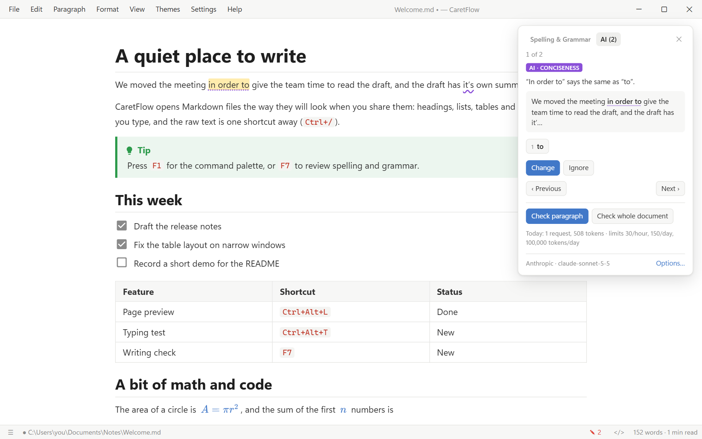
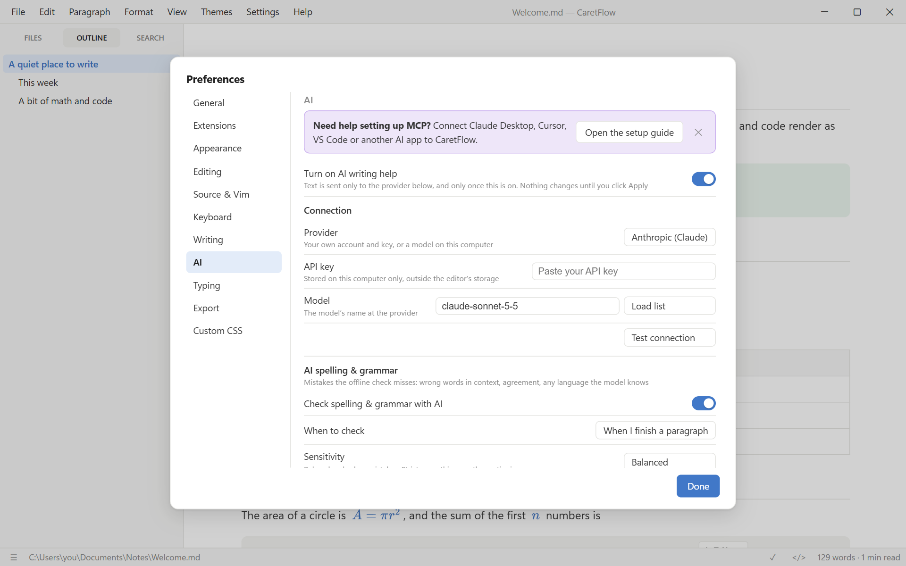

# AI Writing Help

An optional extension that adds corrections and suggestions from the AI **you** choose to
CaretFlow's writing check. It works in two ways, and you can use both:

- **With an API key or a model on your computer**, CaretFlow checks each paragraph you finish, while
  you write.
- **Over MCP**, your AI app (Claude Desktop, Claude Code, Cursor, VS Code, Gemini CLI…) reads the open
  document when you ask it to and sends suggestions back. This uses your app's subscription. Setup:
  [MCP.md](MCP.md).

AI findings appear as violet underlines (wavy for corrections, dotted for recommendations), in the
right-click menu, and in the **AI** tab of the review panel (`F7`). Nothing in your document changes
until you click a suggestion or **Change**.

## Getting started

1. **Preferences → Extensions → AI Writing Help → Install.**
2. **Preferences → AI**: turn on **AI writing help**, pick a **provider**, paste your **API key**,
   enter a **model** (or **Load list**), then **Test connection**.
3. Write. When you finish a paragraph and pause, it is checked.

## Providers

| Provider | API key from | Example models |
| --- | --- | --- |
| Anthropic (Claude) | console.anthropic.com | `claude-sonnet-5-5`, `claude-haiku-5-5` |
| OpenAI (ChatGPT models) | platform.openai.com | `gpt-5-mini` |
| Google Gemini | aistudio.google.com | `gemini-2.5-flash` |
| DeepSeek | platform.deepseek.com | `deepseek-chat` |
| Mistral | console.mistral.ai | `mistral-small-latest` |
| xAI (Grok) | console.x.ai | `grok-4-fast` |
| OpenRouter | openrouter.ai | any model it lists |
| Groq | console.groq.com | `llama-3.3-70b-versatile` |
| Ollama (on this computer) | no key | `llama3.2`, `qwen3`, `gemma3` |
| LM Studio (on this computer) | no key | the model you loaded |
| Other OpenAI-compatible server | if it needs one | llama.cpp, vLLM, LocalAI, a company gateway… |

Model names change often; **Load list** shows what your provider offers. A ChatGPT Plus or Claude Pro
subscription is not an API key: those work through MCP instead.

**Local models** (Ollama, LM Studio, llama.cpp) keep everything on your computer and cost nothing per
request. Smaller models are faster but less careful; 7–8B models work for spelling and grammar.

## Settings

Preferences → AI, top to bottom:

| Setting | Default | |
| --- | --- | --- |
| Turn on AI writing help | off | Nothing is sent before this is on |
| Provider, address, API key, model | | The key is stored in `secrets.json` in CaretFlow's config folder, not in the editor's storage |
| **AI spelling & grammar** | on | Mistakes the offline check misses: wrong words in context, agreement, any language the model knows |
| When to check | When I finish a paragraph | Or: when I pause typing, or only when I ask |
| Sensitivity | Balanced | Relaxed: only clear mistakes (1 per paragraph). Strict: everything (up to 6) |
| **Recommendations** | on | Clearer, shorter, better-fitting wording |
| When to check, sensitivity | as above | Separate from spelling & grammar |
| Look for | clarity, conciseness, word choice | Also: sentence structure, consistency, tone |
| Tone to aim for | no preference | Neutral, formal, friendly, academic, technical |
| Language | same as the text | Or a fixed language |
| Your instructions | | Added to every request, e.g. "British spelling. I use the Oxford comma." |
| Send the paragraph before as context | on | Better answers, a little more text per request |
| Pause before checking | 4 s | 2–30 seconds without typing |
| Skip paragraphs shorter than | 30 characters | |

### Limits

Checking is careful by default and every number is yours to change. When a limit is reached, checking
pauses until the next hour or day; the AI tab and the status bar say so, and **Check anyway** sends one
request.

| Limit | Default |
| --- | --- |
| Max answer length | 400 tokens per request |
| Max text per request | 2,000 characters (longer paragraphs only when you ask) |
| Requests per hour | 30 |
| Requests per day | 150 |
| Tokens per day | 100,000 (sent and received) |
| Temperature | 0.2 |

Today's usage (requests and tokens, as the provider reports them) is shown in Preferences → AI and in
the AI tab, with **Reset**.

## What is sent, and when

- **One paragraph at a time**, after you finished it and paused, plus the paragraph before as context
  (unless you turned that off). Never the whole file, unless you click **Check whole document**, which
  first tells you how many requests that will be.
- Paragraphs that were already there when you opened the file are not sent on their own: only what you
  write or change. **Check paragraph** (`Ctrl+Alt+K`) and **Check whole document** check the rest.
- **Code blocks, inline code and math are never sent.** Inline code is replaced by `[code]`.
- Each answer is remembered for that exact text, so undo, redo and reopening a file cost nothing.
- Requests go straight from your computer to the provider you chose. CaretFlow has no servers.

## Using it

| | |
| --- | --- |
| Right-click an AI underline | The suggestion, why, **Ignore**, **Ignore this kind of suggestion**, **Explain more…** (one extra request) |
| `F7` → **AI** tab | Every AI finding, one at a time, with Change / Ignore / Next; **Check paragraph**, **Check whole document**, usage |
| `Ctrl+Alt+K` | Check the paragraph with the cursor now |
| `Shift+Alt+F7` | Jump to the next AI suggestion |
| Edit menu | AI: Check Paragraph, AI: Check Document, AI: Next Suggestion, AI: Review Panel |

Ignored suggestions stay ignored for that text. When the offline check already marks exactly the same
words, the AI's duplicate is not shown.

## Privacy

- Off until you turn it on; then only the paragraphs described above go to the provider you chose.
- Your API key stays on your computer.
- With a local model, nothing leaves your computer.
- MCP listens on this computer only (`127.0.0.1`) and needs a token; see [MCP.md](MCP.md).

## Troubleshooting

| Message | What to check |
| --- | --- |
| *The provider refused the API key (401)* | The key, and that it belongs to the chosen provider |
| *Rate limit* / *429* | The provider's own limit: wait, or lower Requests per hour |
| *AI answer could not be read* | The model didn't answer in the expected format. Try a larger model or a lower temperature |
| *Could not reach http://localhost:11434* | Is Ollama running (`ollama serve`)? |
| *Choose a model* | Enter a model name or use **Load list** |
