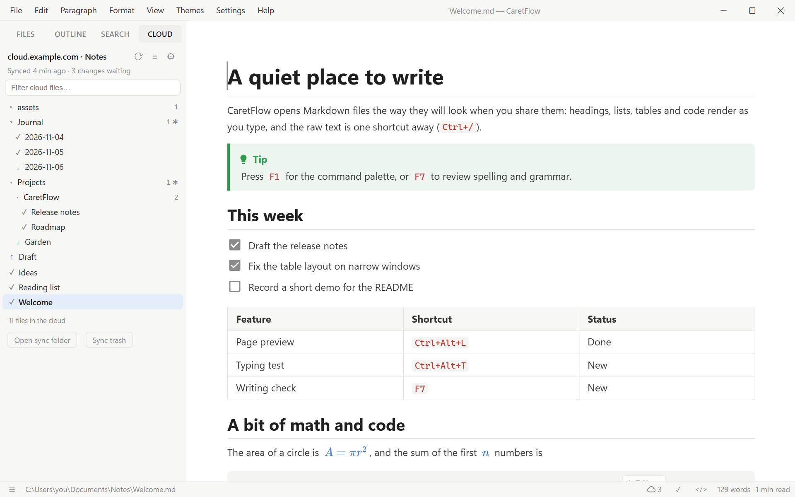

# Cloud Sync

Cloud Sync keeps one folder on your computer in sync with your own server or cloud storage, so
your notes are the same on every computer you write on. It is **optional and off by default**:
CaretFlow has no servers or accounts of its own, and nothing leaves your computer until you turn it
on and choose where it goes.

Cloud Sync is an extension: install it in **Preferences → Extensions**, then turn it on in
**Preferences → Cloud Sync** (also Settings → Cloud Sync…).

## Services

| Service | Works with |
| --- | --- |
| **WebDAV** | Nextcloud, ownCloud, Synology and QNAP NAS, pCloud, Koofr, Box, Infomaniak kDrive, Apache/nginx WebDAV, `rclone serve webdav`, … |
| **S3-compatible** | Amazon S3, Backblaze B2, Cloudflare R2, Wasabi, MinIO, Garage, … |
| **rclone** | Google Drive, Proton Drive, OneDrive, Dropbox, Mega, SFTP and [70+ more](https://rclone.org/overview/), through remotes you set up in [rclone](https://rclone.org) |

### WebDAV (Nextcloud, ownCloud, NAS)

1. **Folder address**: the WebDAV URL of the folder to sync. Create the folder on the server first,
   or let **Test connection** create it.
   - Nextcloud: `https://your.server/remote.php/dav/files/USERNAME/Notes` (Files → Settings, bottom
     left, shows the WebDAV address)
   - ownCloud: `https://your.server/remote.php/webdav/Notes`
   - Synology: enable WebDAV Server in the Package Center, then `https://your-nas:5006/home/Notes`
2. **User name** and **password**. Use an app password if your server has them (Nextcloud: Settings →
   Security → Devices & sessions).

Self-signed certificates: add the certificate to your system's trusted certificates; CaretFlow uses
the system's list.

### S3-compatible storage

| Field | Example |
| --- | --- |
| Endpoint | `s3.eu-central-1.amazonaws.com`, `s3.us-west-004.backblazeb2.com`, `<account-id>.r2.cloudflarestorage.com`, `minio.example.com:9000` |
| Region | `us-east-1` when unsure; `auto` for Cloudflare R2; the region in the B2 endpoint for Backblaze |
| Bucket | the bucket name (create it in your provider's console first) |
| Folder in the bucket | optional, e.g. `notes` |
| Access key / secret key | an access key limited to this bucket is best |

### Google Drive, Proton Drive and others (rclone)

CaretFlow doesn't log in to these services itself. It uses [rclone](https://rclone.org), a free
tool that does, and you set up the login once:

1. Install rclone (`winget install Rclone.Rclone` on Windows, your package manager on Linux).
2. Run `rclone config` in a terminal and add a remote: type `drive` for Google Drive,
   `protondrive` for Proton Drive, `onedrive`, `dropbox`, … Give it a short name such as `gdrive`.
3. In Preferences → Cloud Sync, choose **rclone** and enter the remote and folder, e.g. `gdrive:Notes`
   or `proton:Documents/Notes`. The field suggests your configured remotes.
4. If rclone isn't on your PATH, enter the full path to `rclone.exe` / `rclone`.

## Then

- **Folder on this computer**: the folder that is kept in sync (**Use open folder** takes the one in
  the Files tab). Everything inside it is synced, including subfolders.
- **Test connection** checks the login and the folder.
- **Sync now**: `Ctrl+Alt+S`, File → Sync Now, the cloud button in the status bar, or ⟳ in the Cloud
  tab.

## The Cloud tab

The sidebar's **Cloud** tab (`Ctrl+Shift+4`) lists every file in the cloud folder by folder, or as one
list (≡), with a filter box. Each file shows its state:

| | |
| --- | --- |
| ✓ | synced |
| ↑ | changed on this computer, uploaded on the next sync |
| ↓ | changed in the cloud, downloaded on the next sync |
| ? | exists on both sides from before the first sync; compared on the next sync |
| ! | changed on both sides; both versions are kept |
| ~~×~~ | deleted on one side; deleted on the other on the next sync |

Click a file to open it; a file that is only in the cloud is downloaded first. Right-click for
Reveal in Explorer, **Replace with Cloud Version…** (your copy goes to the sync trash) and Copy Path in
Cloud. The status-bar button shows when the last sync ran and how many changes are waiting; it turns
red when a sync failed (hover for the reason).

## Settings

| Setting | |
| --- | --- |
| Sync automatically | On startup, a few seconds after you save, and when the connection comes back (on by default) |
| Also sync every | 5, 15 (default), 30 or 60 minutes, or never |
| Files to sync | Markdown and images (default), or all files |
| Leave out | Patterns, one per line, like `.gitignore`: `drafts/`, `*.tmp`, `private/**`. Hidden files and folders (starting with `.`) are always left out |
| Deleted files | Delete on the other side too (default), or bring them back |
| Changed on both sides | Keep both versions (default), this computer wins, or the cloud wins |
| Compare everything again | Forget what was synced; the next sync compares every file (nothing is deleted) |

## How it works

- After every sync, CaretFlow remembers each file's state: the time and size on this computer, and
  the version tag the cloud reports (ETag, or time and size for rclone). Next time, whichever side
  differs from that record has changed.
- **Changed on one side**: copied to the other.
- **Changed on both sides** (a conflict): by default the cloud's version is saved next to yours as
  `name (conflict 2026-11-06 1530).md` and both are uploaded, so nothing is lost. Compare them and
  delete the one you don't need.
- **Deleted on one side**: deleted on the other. Files a sync removes from your computer go to the
  **sync trash** (Cloud tab → Sync trash), sorted into folders by date, so you can get them back.
- **Safety check**: if a sync would delete many files at once, or one side is suddenly empty (a wrong
  address, an unplugged drive), CaretFlow asks first. Cancel, keep the files, or go ahead.
- **The open document**: if a sync downloads a newer version of the file you are editing, CaretFlow
  reloads it when you have no unsaved changes, or asks whether to reload or keep yours.
- Changing the service, address, local folder or file types starts fresh: the next sync compares
  every file instead of trusting old records.

## Privacy

Your files go only to the server or storage you set up. Passwords and keys are stored in
`secrets.json` in CaretFlow's config folder (readable only by your user), not in the editor's
web storage. With rclone, CaretFlow never sees your login: rclone keeps it in its own config.
Files are not encrypted by CaretFlow; use HTTPS, and a service you trust or an encrypted rclone
remote ([crypt](https://rclone.org/crypt/)) if you need encryption at rest.

## Troubleshooting

| Message | What to check |
| --- | --- |
| *the server refused the login (401)* | User name and password; Nextcloud with 2FA needs an app password |
| *not found on the server (404)* | The folder address; **Test connection** offers to create the folder |
| *rclone was not found* | Install rclone or enter its full path in Preferences |
| *SignatureDoesNotMatch* (S3) | Secret key, region, and that the endpoint has no bucket name in it |
| A sync is slow the first time | Files that exist on both sides are compared once, which downloads them; later syncs only move changes |
