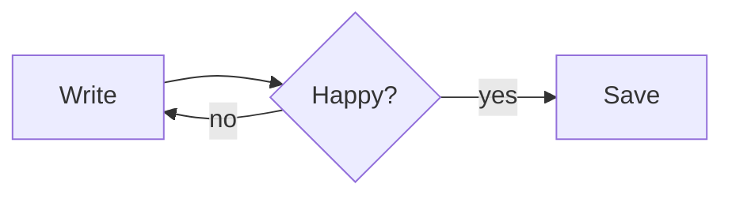

# Welcome to CaretFlow

CaretFlow is a **seamless** Markdown reader and editor: what you type is rendered *in place*, with no split preview. Press `Ctrl+/` at any time to see and edit the raw Markdown.

## Quick start

- `Ctrl+O` open a file, `Ctrl+Shift+O` open a folder, `Ctrl+P` jump to any file in the folder
- `Ctrl+Shift+P` command palette — every feature is in there
- `Ctrl+Shift+L` toggle the sidebar (outline, files, folder search, cloud files)
- `F8` focus mode, `F9` typewriter mode, `Ctrl+Shift+J` zen mode
- `Ctrl+Shift+R` read-only mode — `Ctrl+Click` (or just click, when read-only) opens links
- Type `/` on an empty line for the block menu
- Prefer Vim? **View → Vim Keybindings** (`Ctrl+Alt+V`) — works in source mode, with `:w`, `:q`, `:wq`; line numbers (also relative) under **View → Line Numbers**
- Change any shortcut in **Preferences → Keyboard** (**Help → Customize Shortcuts…**): click it, press the new keys
- **File → Close File** (`Ctrl+F4`) and **File → Close Folder** start over with an empty document or file tree; **Preferences** (`Ctrl+,`) has fonts, heading spacing, line numbers and more, sorted by topic
- **Help → Check for Updates…** finds a new version; **Update & Restart** installs it and opens CaretFlow again

## Spelling & grammar

CaretFlow checks your writing as you type, like a word processor: red wavy lines are spelling, blue double lines are grammar (*their/they're*, *could of*, *a apple*, repeated words). Right-click a marked word for suggestions, or press `F7` to go through every issue (`Alt+F7` jumps to the next one). Common typos such as *teh* are fixed while you type; press `Backspace` right after to undo a fix.

The default checker (Harper) runs entirely on your computer. For German, French, Spanish and other languages, switch to LanguageTool in **Preferences → Writing**.

## Extensions

Bigger optional features are extensions: **Tools → Extensions…** installs them with one click, and until then they stay out of your menus. **Cloud Sync** keeps a folder in sync with your own server, **AI Writing Help** adds suggestions from the AI you choose (or your AI app over MCP: **Help → AI Setup Guide**), and the **Typing Test** measures your speed.

## Typing test

With the Typing Test extension installed, `Ctrl+Alt+T` opens a typing test: 15–120 seconds or 10–100 words, optionally with punctuation and numbers, or with text from the open document. **Tools → Typing Speed (WPM)** shows your speed while you write, and **Tools → Typing Cat** adds a small companion.

## Cloud Sync

Keep a folder in sync between your computers with your own server or storage: WebDAV (Nextcloud, ownCloud, a NAS), S3-compatible storage (B2, R2, MinIO, AWS), or Google Drive, Proton Drive and others through rclone. Install it in **Tools → Extensions…**, then turn it on in **Preferences → Cloud Sync**; CaretFlow has no servers of its own. `Ctrl+Alt+S` syncs now, and the **Cloud** tab in the sidebar (`Ctrl+Shift+4`) shows every file in the cloud with its sync state. When a file changed on both sides, both versions are kept.

## Inline formatting

You can write **bold**, *italic*, ~~strikethrough~~, `inline code`, [links](https://example.com) and inline math like $e^{i\pi} + 1 = 0$.

> Blockquotes look like this.
> They can span several lines.

## Callouts

> [!TIP]
> Paragraph → Callout turns a paragraph into a note, tip, important, warning or caution box.

> [!WARNING]
> Click on the title line to see (and change) the `[!WARNING]` marker.

## Lists

1. Ordered item
2. Another item
   - Nested bullet
   - And another

- [x] Task lists
- [ ] Click the checkbox to toggle

## Tables

| Shortcut | Action |
| --- | --- |
| `Ctrl+T` | Insert table |
| `Ctrl+Shift+K` | Code block |
| `Ctrl+Shift+M` | Math block |

## Code

```js
function greet(name) {
  return `Hello, ${name}!`
}
```

## Math

$$
\int_0^\infty e^{-x^2}\,dx = \frac{\sqrt{\pi}}{2}
$$

## Diagrams



## Images

Paste an image from the clipboard or drag one in from Explorer. CaretFlow copies it into an `assets` folder next to your document and links it relatively (configurable in Preferences).

---

Check page layout with **File → Page Preview** (`Ctrl+Alt+L`), add page breaks with `Ctrl+Enter`, and export with **File → Export as PDF** or **File → Export as HTML**.
