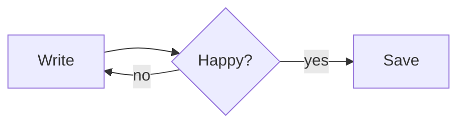

# Welcome to Folio

Folio is a **seamless** Markdown reader and editor: what you type is rendered *in place*, with no split preview. Press `Ctrl+/` at any time to see and edit the raw Markdown.

## Quick start

- `Ctrl+O` open a file, `Ctrl+Shift+O` open a folder, `Ctrl+P` jump to any file in the folder
- `Ctrl+Shift+P` command palette — every feature is in there
- `Ctrl+Shift+L` toggle the sidebar (outline, files, folder search)
- `F8` focus mode, `F9` typewriter mode, `Ctrl+Shift+J` zen mode
- `Ctrl+Shift+R` read-only mode — `Ctrl+Click` (or just click, when read-only) opens links
- Type `/` on an empty line for the block menu
- Prefer Vim? **Settings → Vim Keybindings** (`Ctrl+Alt+V`) — works in source mode, with `:w`, `:q`, `:wq`

## Inline formatting

You can write **bold**, *italic*, ~~strikethrough~~, `inline code`, [links](https://example.com) and inline math like $e^{i\pi} + 1 = 0$.

> Blockquotes look like this.
> They can span several lines.

## Lists

1. Ordered item
2. Another item
   - Nested bullet
   - And another

- [x] Task lists
- [ ] Click the checkbox to toggle

## Tables

| Shortcut | Action |
| --- | --- |
| `Ctrl+T` | Insert table |
| `Ctrl+Shift+K` | Code block |
| `Ctrl+Shift+M` | Math block |

## Code

```js
function greet(name) {
  return `Hello, ${name}!`
}
```

## Math

$$
\int_0^\infty e^{-x^2}\,dx = \frac{\sqrt{\pi}}{2}
$$

## Diagrams



## Images

Paste an image from the clipboard or drag one in from Explorer. Folio copies it into an `assets` folder next to your document and links it relatively (configurable in Preferences).

---

Export with **File → Export as HTML** or **File → Print / Export PDF**.
